# Automating a media team with GANs, ImageMagick and ffmpeg (2017–2018)

**Luke Riley** · co-built with Rob Durland · Rentping

**Abstract.** In 2017–2018 Rob Durland and I built an AI pipeline that edited
Rentping's real-estate photos and walkthrough videos automatically.
Rentping/Rentvision had grown at a CAGR of ~30%, and while other teams were
created and grew, the media team stayed about the same size. Photoshop actions
and templates could only take it so far.

A CycleGAN learned our editors' look from before-and-after examples. Instead of
shipping the GAN's pixels, we captured its brightness and colour decision as a
colour LUT (lookup table), an idea we first proved on our walkthrough videos,
and applied that LUT at full resolution with the original photo's own detail.
That removed the GAN's artifacts, sped everything up, and passed blind QA.
Scripts on each team member's Dropbox watch folder handled every export size,
upload and delivery, around the clock, in under 4 seconds per photo (estimated
for the 2018 production machine).

The first images passed QA about 4 months after the idea, and within a year
the system had taken over at least half of the team's in-office work. It ran
in parallel with the team rather than replacing anyone: several times faster
than a person per photo, and around the clock, nights and weekends included,
so it could edit roughly 40–140 times as many interior photos per calendar week as the
whole team's editing hours allowed (estimated; see *Results*). Editors moved on
to specialist and creative marketing work for the whole company, and the
company could keep growing without hiring editors in step with it.

## The problem

Rentping, a multifamily marketing platform, had grown about 30% a year,
compounded, for years. Other teams were created and grew with it, and the
media team stayed roughly the same size by finding efficiencies. By spring
2017 it had reached the Pareto limit of what people could do by hand.
Templates, presets, Photoshop actions and video LUTs had taken the easy gains;
each further gain cost more than the last.

Each shoot produced exterior photos, hundreds of interior photos and
continuous walkthrough videos of a site's floor plans. Every photo was edited
by hand, every video colour corrected, cut and edited by hand, and every file
uploaded and logged by hand. The team was the bottleneck between a shoot and
the client's listing going live.

The media team was six people, and at any time most of us were on the road
shooting. I travelled about 15 workdays a month; some travelled more, some
less. Editing happened mostly on office days or when flying, and often only one or two of us were in
the office at a time. Those days could also hold meetings, breaks, email and every
other task, so the hours left for actual editing weren't a full 8hr every day.

**A fast editor managed about 60 seconds per interior photo (exteriors took
longer by hand), then still had to export several sizes and upload them by
hand, and only in the editing hours of an office day. A computer could work 24/7, 365 days a year.**

We were self-taught, and we built it mostly on nights and weekends.

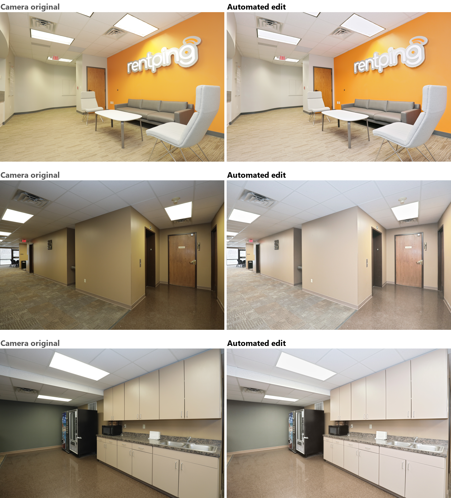

*Rentping's own office: camera original, then the automated edit, untouched by
a person. The edits use our late-2018 method: the model picks the look from a
512 px preview, and a colour LUT plus the original's own detail make the
full-resolution photo.*

> I came to this as a photographer and videographer with an art degree, not a
> software engineer. I built it while still doing my full job: shooting
> apartment communities on the road about 15 workdays a month, and editing my
> own shoots by hand in the office.

---

## How it started

Our CEO came to Rob and me with an idea he'd had in a dream: editing our photos
and videos with AI. The software team said it couldn't be done. I'd followed AI
research as a hobby for years, so I said we'd try.

Through the fall of 2017 I fell asleep after midnight most nights reading papers
from Andrej Karpathy's arxiv-sanity, printing them out and trying candidates.
The first real attempt, in late September, was Google's **HDRNet** (SIGGRAPH
2017), which learns an edit from a low-resolution copy and applies it at full
resolution: exactly what we wanted. But the open-source code was very much
"works on the author's machine", we never got it fully running, and it trains
on exact before/after pairs, which our archive didn't have in clean form. Its
core idea came back later as the LUT.

Apple's [*Improving the Realism of Synthetic
Images*](https://machinelearning.apple.com/research/gan) (2017) was the turning
point. It used a GAN to make synthetic eye images realistic enough to train
gaze detection on. If a GAN could make computer-generated eyes look real, it
could plausibly make an unedited photo look edited. That
led me to **CycleGAN** ([Zhu, Park, Isola and Efros,
2017](https://junyanz.github.io/CycleGAN/); we built on their open-source
[PyTorch code](https://github.com/junyanz/pytorch-CycleGAN-and-pix2pix)). It learns to turn one set of images
into another (unedited to edited) without needing exact before/after pairs,
which suited how our archive was organised.

**Timeline:** workstation set up late September 2017, first model trained
October 6, production model trained late December, in production that winter.
The LUT came later, from video: capturing the model's keyframe edits as LUTs
made the walkthrough videos practical, and only then did we bring the idea back
to photos, where it cleaned up the edits and sped up the whole pipeline.
Automatic YouTube and Wistia uploads landed around September or October 2018,
as best I remember.

## What we built

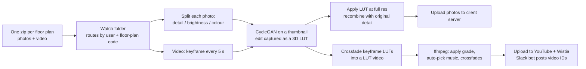

### Data and training

- **We curated every training set** from our own shoots: interiors,
  exteriors, raw vs. edited JPEGs, grass and sky replacement, and empty vs.
  furnished units.
- **Garbage in, garbage out, so we fixed the capture too.** We standardised
  how the team shot: the camera's electronic level on in the viewfinder, so
  verticals and horizons came in straight, and a custom in-camera JPEG profile
  that normalised colour and contrast and turned off in-camera sharpening.
  Photos shot that way needed little or no hand editing, and the model saw
  consistent input. The whole team adopted it, which mattered because edits
  went into one shared queue: we edited each other's shoots. Perspective was
  still never quite perfect, so editors corrected it by hand, and automatic
  perspective correction was on our list too.
- We trained **13 CycleGAN and pix2pix models** in PyTorch/CUDA, tracked in
  visdom with every loss curve logged. They covered interior enhancement, RAW
  highlight recovery, grass and sky replacement, and multi-stage refinements.
  We focused on interiors rather than exteriors because interiors vary less.
- **Hardware on a budget:** we developed and first ran production on my
  personal gaming PC (two GTX 1070s, brought into the office). Two cards meant
  two experiments at once, roughly halving each round, but not higher
  resolution: each model still had to fit in one card's 8 GB. An enterprise GPU
  on Google Cloud ran about $1,000 a week, so we bought a **used Quadro P6000
  (24 GB) for about $3,000**: three weeks of cloud time for a card we owned,
  and it made high-resolution training possible.
- **Scaling Laws: A production machine built for the real bottleneck:**
  training needs GPU memory, but production needed something else. With the
  model seeing only a 256–512 px thumbnail, inference took a fraction of a
  second, and the time went into CPU-bound full-resolution ImageMagick work. So
  the production box paired a water-cooled GTX 1080 Ti with close to the
  highest-core-count AMD CPU we could get, SMT doubling the threads. We called
  it **Hercules**, after the myth and the C-130 Hercules, the military's
  heavy-lifting workhorse transport.
- **The faster machine exposed race conditions.** On my PC, slow hardware
  happened to make things finish in order: the background ImageMagick prep
  always took longer than the model, so the model's output was there when
  post-processing looked for it. On the new machine, post-processing sometimes
  ran first, shared folders were cleaned up while the next job was using them,
  and a fixed `sleep 5` stood in for "wait until the upload finishes". I rebuilt
  the orchestration so ordering never depended on timing: explicit completion
  checks before every step, and a separate temp folder per image, cleaned up
  when it finished. Then everything could run in parallel, keeping the CPU, RAM
  and GPU fully busy.
- We modified the CycleGAN codebase for high-resolution inference (up to
  2,700 px), multi-GPU selection and OpenCV 3 compatibility.

### An edit that looks human, not "AI"

Raw CycleGAN output got the overall edit right, brighter and cleaner like a
finished listing photo, and plenty of images began to pass QA. But it broke
down in predictable places, worst of all light sources, especially recessed
ceiling cans. On one October 2017 test image from the archive:

- **Light fixtures:** a real light has a soft **highlight roll-off**, bright
  at the centre and fading smoothly into the ceiling. The model lost it: on a
  ceiling dome light it found the pure-white patch and traced around it,
  turning the soft glow into a flat white shape with a hard, ragged outline.
- **Windows and glass doors:** the plants outside turned into gritty,
  high-contrast grey texture, with the colour drained out.
- **Saturated colours:** a green pillow came out beige, and red flowers on a
  curtain came out brown. The model had learned that edited apartments are
  bright and neutral, and pulled everything that way.
- **Fine texture:** a textured ceiling came out crunchy and over-sharpened.

The worst was in the brightest and darkest areas, where pixels clip to pure
white or black and no real detail is left. The only feature the model sees
there is where clipping starts, so it treats that boundary as an edge and
sharpens it: lights came out outlined instead of glowing.

The colour loss was fixed before the LUT, with data rather than code. The early
training sets were mostly neutral, empty units, so the model learned that
"edited" meant beige. I curated a set with many more staged model units full of
real colour (pillows, art, rugs), and after retraining, coloured decor came
through correctly.

The final production model was trained on the Quadro P6000 at a higher
resolution than our 8 GB gaming cards allowed (they topped out at ~420 px
crops). It shows in the model's own output, before any finishing: it handles
pure white, pure black and high-contrast areas far better than the early model.
That was our own evidence that scaling laws worked: training at higher
resolution improves what comes straight out of the model.

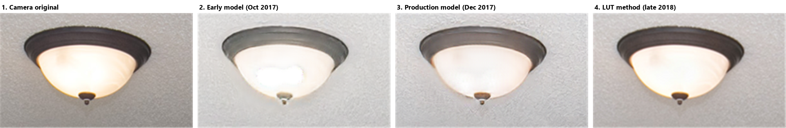

*Ceiling dome light. The early model (Oct 2017) traces the clipped white
inside the glass into a hard-edged blob. The production model (Dec 2017)
leaves only a faint, soft glow that rolls off into the glass and ceiling, and
removes the orange cast. The LUT method (panel 4) also keeps the glass's swirl
texture, because all fine detail comes from the original.*

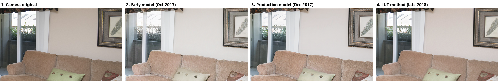

*The early model turned the green pillow beige and drained the colour from
the plants outside. Retrained on more staged, colourful model units, the
production model brightens and white-balances the room while keeping the green
and red pillows their real colours. The LUT method adds the original's texture
back: crisp couch fabric, natural plants outside.*

Panels 2 and 3 are raw model output; neither model trained on these photos.
Panel 4 jumps ahead to where we ended up in late 2018, the **LUT method**
(explained after the video section): the model picks the look from a 512 px
thumbnail, and every pixel of detail comes from the original. On the dome light
it's a milder edit than the raw model (average brightness 63 → 71, against 75).

**Proof it worked:** for a month or two, ML-edited photos went through our
normal QA without reviewers knowing they were AI-edited, and they passed. That
won over the project's skeptics. Our media team manager was blown away when he
learned we'd been submitting model-only output through the winter and early
spring. He gave us an analogy we carried into the next phases: a house seems to
go up fast, but the finishing work takes the time. The outputs were good, but
still had a little way to go to match a human editor.

### The finishing chain: the April 2018 method

The model's output was never the deliverable, even once it passed QA. These are
full-resolution camera JPEGs (6720 × 4480) of our office, run as production ran
them: the production model at 2,700 px, then the April 2018 finishing chain at
3840 × 2560 using the full-resolution original. Together, that's what we call
the **April 2018 method**. The chain does brightness recombination, two passes
of automatic white balance, a high-pass detail layer from the original, 150%
saturation, sigmoidal contrast and a light sharpen.

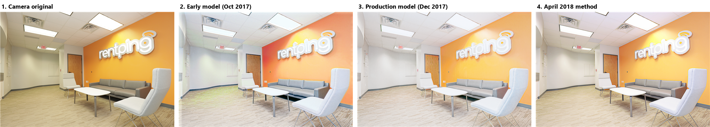

*The camera original has a yellow-green cast from the office lighting. The
early model removes it but turns the orange wall red and leaves a green blotch
on the floor. The production model neutralises the walls and ceiling and
keeps the brand orange orange. The April 2018 chain restores the original's
sharpness and adds contrast and colour: a finished photo.*

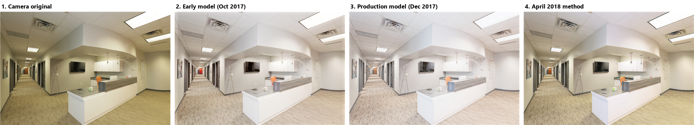

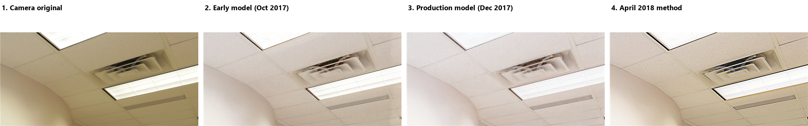

*Around lights, the April 2018 chain still struggled. The production model
leaves the panels clean, but the chain's high-pass detail and 150% saturation
draw a dark, slightly orange outline around each one and make the ceiling
gritty. The LUT method (after the video section) was built to fix problems like this.*

*Made from archived camera JPEGs and model weights, with the original 2017
network code and the April 2018 script's settings, on ImageMagick 7 rather than
2018's 6.8.9, so small differences from the 2018 output are expected.*

The chain splits each photo into three parts and lets the edit change only what
it should:

- **Detail:** a full-resolution high-frequency map from the original
  (Difference-of-Gaussians), layered back on at the end, so sharpness always
  comes from the real photo.
- **Brightness and contrast:** taken from the model's output at large scale
  only, merged into the original's luminance.
- **Colour:** handled separately, blended with the model's output with
  automatic white balance.

Luma masks confined each change to a tonal range, so window highlights and dark
corners were treated differently. It's the reasoning behind typical image
compression: people notice brightness detail far more than colour detail, so
colour can be handled coarsely and the effort spent on luminance.

### Video: ML colour grading for no-cut walkthroughs

Our videos were 60 fps continuous, no-cut walkthroughs: daylight through
windows, yellow tungsten in bathrooms and closets, green fluorescent in
kitchens, all in one take. Grading shot by shot doesn't work when there's only
one shot.

My first test, in March 2018, extracted every frame with ffmpeg and ran each
through CycleGAN and the full photo finishing chain, one after another. A whole
video took over a week.

That's where the LUT idea came from. Our editors already graded video with
LUTs, so instead of running the model on every frame, we let it edit a keyframe
every few seconds and captured each edit as a LUT. Only later did we bring it
back to photos (next section).

1. Extract a keyframe every 5 seconds with ffmpeg.
2. Edit each keyframe with the photo pipeline: the model on a small copy, with
   a light Retinex blend (a NASA haze-removal method, described below) added
   before the LUT is captured, which made each LUT stronger.
3. Crossfade consecutive LUTs over each interval and render them as a "LUT video".
4. Apply the LUT video to the footage with ffmpeg.

Video jobs ran in parallel: every ffmpeg job went into the background in bash,
all at once, and each step checked its input was complete before using
it, so nothing raced, failed or picked up a half-written file.

The grade follows the camera from room to room with no visible jumps. Because a
3D LUT depends on colour, it also corrects mixed lighting within a frame, and
white balance stayed true in empty units and furnished models alike.

The test: 3 minutes of 1080p at 59.94 fps, 10,764 frames, on a GTX 1070.

| Same 3-minute walkthrough, same PC | Time |
|---|---|
| Every frame: our March 2018 script, as written (one frame at a time) | ~8.4 days (67.7 s per frame) |
| Every frame, with the parallelization we later built for photos | ~42 hours (14.1 s per frame) |
| Best case: production model only, one pass, no finishing (not how we ran it) | ~3 h 34 min (1.2 s per frame) |
| **Keyframe LUT method** | **18 min 53 s** (measured end to end, CPU x264 encoding as in our 2018 script) |

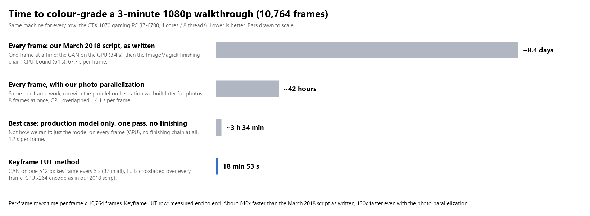

The GAN ran on the GPU in every row, and was only about 3.4 s of each frame's
67.7 s. The week came from everything after the model: the CPU-bound
ImageMagick finishing chain, run again on every frame.

That's about **640× faster** than our March 2018 script, and about 130× faster
even with the photo parallelization applied to every frame. In the model, two
savings multiply: it sees 37 keyframes instead of 10,764 frames, and a 512 px
thumbnail instead of a full 1080p frame, so its work drops from 2 h 22 min of
GPU time to 2.6 seconds. Each keyframe's edit becomes a LUT, so no frame needs
its own finishing chain; the camera's detail is already in every frame. Nearly
all of the remaining 19 minutes is ordinary video work (applying the grade at
full resolution and encoding, with x264 on the CPU as in the surviving script),
run in parallel: each 5-second stretch starts as soon as its two keyframes
are done, in the background, while the GPU works on later ones.

It also looks better. A GAN redraws every frame independently, so the grade
wanders and pulses and textures get re-invented. The LUT grade can only change
as fast as the 5-second crossfade:

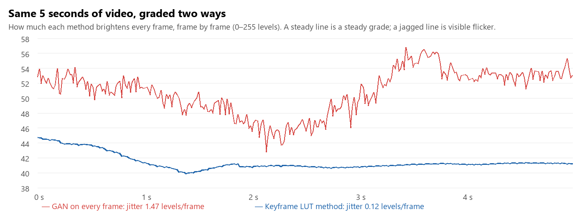

Across seven 5-second stretches of the walkthrough, the GAN's brightness
jitters 4 to 15 times more than the keyframe LUTs:

| 5-second stretch | GAN on every frame | Keyframe LUT method |
|---|---|---|
| 3 s, living room, window light | 1.47 | 0.12 |
| 28 s, kitchen | 0.94 | 0.13 |
| 40 s, kitchen sink | 0.60 | 0.16 |
| 70 s, bathroom vanity | 0.99 | 0.15 |
| 138 s, bedroom window | 1.26 | 0.08 |
| 148 s, bedroom, ceiling-fan light | 1.22 | 0.11 |
| 158 s, bathroom | 1.07 | 0.13 |

*Jitter: how much the brightness lift changes from one frame to the next, in
0–255 levels (lower is steadier). GAN frames are one pass of the production
model; LUT frames are the 2018-faithful run above.*

Each stretch shows something different about the grade: colour under window
light, the black fridge staying crisp and shiny instead of grey noise, warm
bathroom bulbs corrected, and the wood floor kept instead of redrawn.

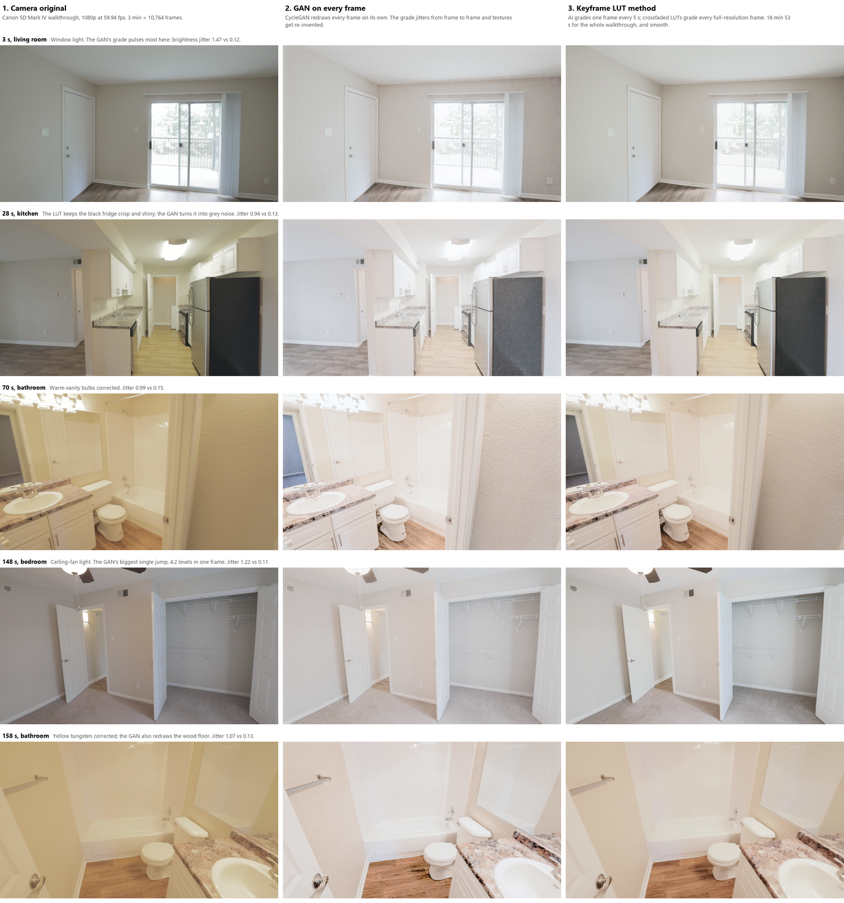

All five in real time (25 s at 59.94 fps, looping), stacked so each GAN pulse
shows down the frame: camera original, GAN on every frame, keyframe LUT method:

*Full-quality version: [video-segments.mp4](images/video-segments.mp4).*

https://github.com/user-attachments/assets/6128f402-1aab-481d-8bf4-03b949e35296

### Back to photos: the LUT method (late 2018)

With keyframe LUTs working on video, we brought the idea back to photos, and it
improved both the output and the speed. **The fix was to stop using the model's
pixels and use its decision instead.** Rob and I discussed capturing each
photo's edit as a 3D LUT: a table mapping each input colour to an output
colour, fitted across the whole image. Rob built the first working
implementation. A LUT
depends only on a pixel's colour, never its position, so it physically can't
reproduce a local blotch, and because it's fitted across millions of pixels,
the few bad ones barely affect it. What gets through is what the model got
right: the overall brightening, contrast and white balance. Lights keep the
original's natural falloff, and the blown-out blobs, gritty windows and
over-sharpening are left behind, because they're local. The edit is consistent
across the photo, the way a human editor's would be.

The LUT method also borrowed from NASA. **Retinex** (Multiscale Retinex
with Color Restoration, from NASA Langley Research Center) was built to pull
detail and natural colour out of hazy aerial and satellite images; we found it
through NASA Langley's [Retinex Image Processing
page](https://web.archive.org/web/20180325055337/https://dragon.larc.nasa.gov/retinex/),
with its before-and-after aerial photos taken through haze. It compares each
pixel with its surroundings at several scales, lifting shadows and cutting
haze. We built our own from the same pieces as the rest of the pipeline: the
photo blurred at several sizes in each image's scratch folder, recombined the
way NASA's multi-scale method does. At full strength it looks over-processed,
so we blended in just enough to clear the murk from dim interiors.

### Making it fast

| Change | Effect |
|---|---|
| Post-processing runs while the GPU starts the next photo | 45.9% faster in one release |
| TIFF intermediates and fewer steps | **26% of the original per-photo time** |
| **Thumbnail inference plus a LUT:** run the model on a 256–512 px copy, capture its edit as a 3D LUT, apply that to the full-resolution photo, and keep the high-pass detail and recombination at full resolution | ML edit in about **0.1 s per photo** |
| Production machine sized for the new bottleneck: water-cooled GTX 1080 Ti plus a high-core-count AMD CPU, with ImageMagick stages parallelised across every thread | full-resolution finishing ran in parallel instead of in a queue |

On photos, the LUT paid off twice. One small table carries brightness,
contrast, saturation and white balance together, so the model only needs a
thumbnail to decide *how* to edit, and the full-size photo gets a cheap lookup
(close to the insight behind Google's HDRNet, built with bash and ImageMagick).
Per-photo time on the gaming PC fell from 95 s to 29.5 s, and the output got
better, as the comparisons below show.

One full-resolution office photo, timed with the archived model weights and
scripts on the GTX 1070 gaming PC:

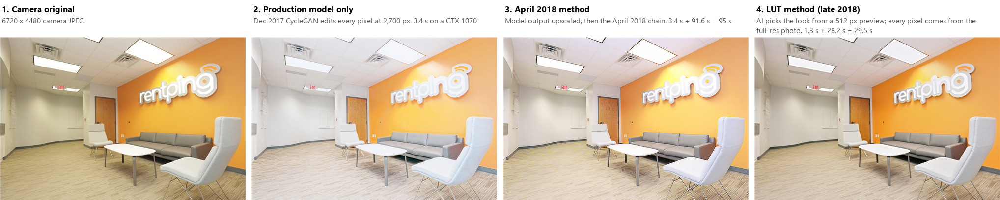

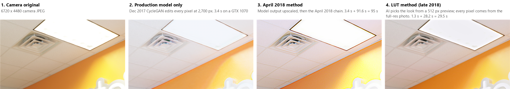

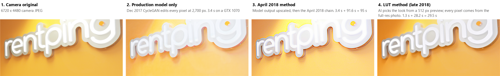

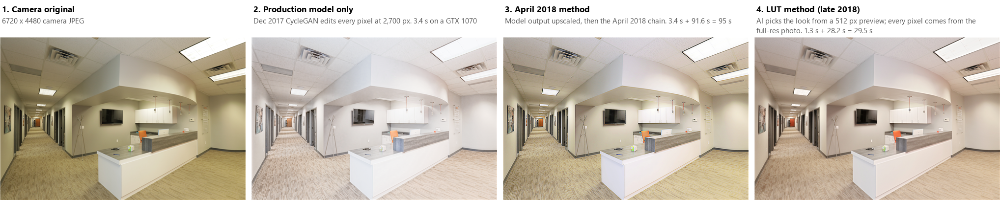

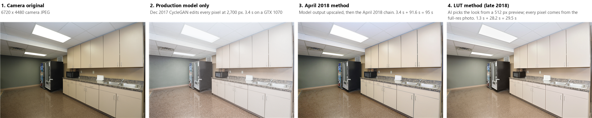

*Times measured on my gaming PC, model on a GTX 1070. **Production model
only:** the model edits every pixel at 2,700 px (3.4 s); alone, it softens
detail and flattens the light panels. **April 2018 method:** that output upscaled and run through
the April 2018 chain, 95 s per photo; the chain restores punch but blows out
the logo edges and outlines the lights. **LUT method:** the AI only picks the
look from a 512 px preview, and that look becomes a colour LUT applied to the
**full-resolution camera photo**, so every final pixel comes from the original
6720 × 4480 image, never an upscaled AI image. With the detail layers, 15%
Retinex and three sharpened export sizes it takes 29.5 s and looks better:
highlight detail survives (the fluorescent diffuser cells, the shading on the
logo letters) and nothing fringes. Both methods deliver 3840 × 2560.*

### Sharpening like an editor, per output size

Our editors sharpened with a different preset for each delivery size. Measuring
detail against overall contrast across hundreds of the team's photos, human
edits were **about a third crisper than the pipeline's originals at web size**
but **softer at full size**: smooth, noise-free masters, with sharpening saved
for the web exports.

Each photo shipped at three sizes, one per place it appeared on the site:
3840 × 2560 for full-width web banners, 1200 px wide for image carousels, and
1500 px wide for viewing a carousel image full size.

The pipeline does the same. The 3840 × 2560 master gets no extra sharpening and
as little compression as possible. Each web size is resized with a sharp
resampling filter, then sharpened carefully:

- **brightness only**, so colours never fringe or get noisy
- **through an edge mask**, so window frames, cabinet edges and furniture lines
  get crisp while flat walls and smooth gradients are left alone
- **with a noise threshold**, so grain and JPEG artifacts aren't amplified

The amount was tuned by trial and error until the web exports matched the human
edits' measured crispness. Each size is then compressed at its own JPEG quality.

### Making it fast, part 2: keeping every core busy

The LUT made each photo cheaper; the orchestration work I focused on turned that
into throughput. One photo at a time, even the LUT method leaves most of the
machine idle: the GPU waits while the CPU finishes a photo, and most cores wait
while one ImageMagick step runs.

So I made nothing wait except the final assembly:

- **The GPU works through a queue:** every photo runs through the model back
  to back.
- **All the CPU work launches at once, in the background, for every photo.**
  Each photo gets its own scratch folder, and each piece of work is its own
  job writing its own named layer: the full-resolution original, brightness
  detail bands, Retinex blurs at several scales, and the LUT layer as soon as
  that photo's model output lands.
- **Each photo's assembly script waits only for its own pieces**, checks they
  were completely written, builds the final, publishes it, and cleans up its
  scratch folder.

The operating system schedules all of it. On the production machine, with 32
threads and a water-cooled GTX 1080 Ti, the GPU, every CPU thread and the RAM
stayed saturated, once the race conditions that fast hardware exposed were
fixed (see *The faster machine exposed race conditions* above).

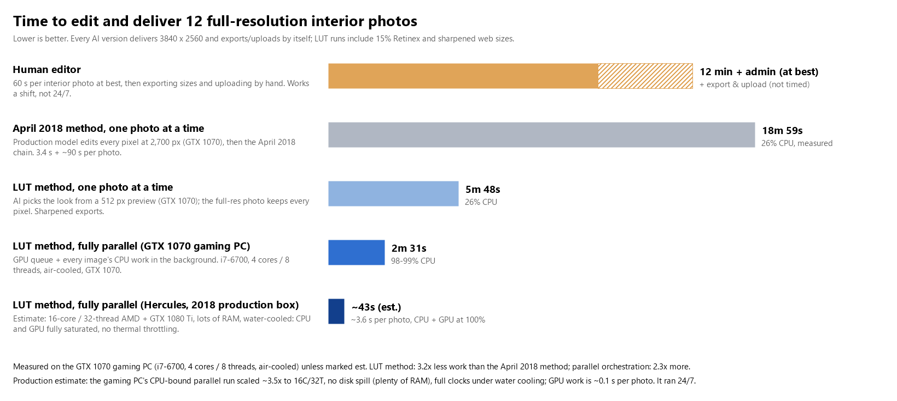

*My gaming PC: air-cooled i7-6700 (4 cores / 8 threads), GTX 1070 running the
model. The parallel time is the average of two runs (2 min 35 s and 2 min 26 s).*

| 12 full-resolution photos | Wall time | CPU busy |
|---|---|---|
| Human editor (60 s per interior photo at best) | 12 min editing, then exporting and uploading by hand | n/a (working shifts only) |
| April 2018 method, one at a time | 18 min 59 s | 26% |
| LUT method, one at a time | 5 min 48 s | 26% |
| LUT method, fully parallel (GTX 1070 gaming PC) | 2 min 31 s | 98–99% |
| **LUT method, fully parallel (Hercules, 2018 production box)** | **~43 s (est.)** | 16 cores / 32 threads + GTX 1080 Ti |

Finishing is **CPU-bound**, so the production figure is an estimate from
memory: the gaming PC's parallel run scaled to a 16-core / 32-thread AMD CPU
(about 3.5× the throughput for this all-cores work), with enough RAM that
nothing spilled to virtual memory, and water cooling so the CPU and GPU ran
flat out with as little thermal throttling as possible.

That's **3.2×** less work per photo from the LUT method and **2.3×** more from
the orchestration: about **7.5×** overall on the air-cooled 1070 PC, and
roughly **26×** the April 2018 method on the production box.

### Removing the manual work around the edits

- **Music:** measure the video's length, randomly pick a royalty-free track at
  least that long, trim it and crossfade it in and out.
- **Delivery:** one zip per floor plan, named with its code. Photos went to
  the client's server, videos to YouTube and Wistia, and a Slack bot posted the
  video IDs: no manual uploading or data entry. Once the system had proven
  itself, in summer 2018 the company built an API endpoint for it: if the zip
  carried the right code, the machine posted the finished photos and video IDs
  straight into the system that served client websites.
- The orchestration grew from one 300-line bash script into a master script
  calling a sub-script per stage, with production and test branches in git.

## Results

- **Interior photos and walkthrough videos were completely automated**, from
  the photographer's upload to the client's listing, with no one touching them.
- Took over **more than half of the media team's in-office work**: editing,
  colour, music, uploads and data entry.
- Edits passed blind QA.
- Ran unattended, 24/7, with multi-user routing, on consumer GPUs.

**Against a human editor.** The 2018 production machine did the edit *and* the
three export sizes in under 4 seconds per photo (an estimated 43 seconds for
the 12 interior photos above, against about 12 minutes of editing alone for a
person at 60 seconds a photo). Even the GTX 1070 gaming PC (4 cores) takes about 13
seconds per photo. Uploads aren't counted on either side. And 60 seconds is a
person's best case at full focus; a real day also has lunch, breaks, stand-ups,
meetings and interruptions. The machine ran nights and weekends too, so even
the slow early version beat a person over a full week.

**Per calendar week**, the gap is far larger than per photo, because the team
only edited in the office hours left between travel and everything else:

| Interior photos edited per calendar week | Capacity |
|---|---|
| One editor on my schedule (about 1.5 office days a week) | ~370–650 |
| The whole team (one or two editors in the office on any workday) | ~1,200–4,200 |
| One editor, theoretical maximum (in the office all week, 40 hours of nothing but editing) | 2,400 |
| GTX 1070 gaming PC, around the clock (measured, 12.6 s per photo) | ~48,000 (11–40× the team) |
| **Hercules, the 2018 production box, around the clock** (estimated, 3.6 s per photo) | **~170,000 (40–140× the team, 260–450× one editor)** |

*Assumptions: interior photos only, at a fast editor's best case of 60 seconds
each, editing only (exporting and uploading not counted). Exteriors took longer
by hand and weren't automated, so they're left out on both sides; 4 to 7 hours of editing in a 9-to-5
office day, depending on the day, once breaks, meetings and email are taken
out; 5 workdays a week and about 15 of a month's ~22 workdays on the road.
Some editing also happened on flights, but it varied too much to count, so the
team figures run a little low. The theoretical maximum assumes one editor at the desk for a full 40-hour week
with no travel and nothing but editing: no meetings (team or company-wide), no
email, no coworker interruptions, no bathroom or other breaks. No real week
looked like that. The machine figures are capacity around the clock,
including the three export sizes; in practice the machine was limited by how
many shoots came in, not by its own speed.*

Even against that theoretical maximum, Hercules could do about 70 times the
work: it had
4.2 times the hours (168 a week against 40) and was about 17 times faster per
photo (3.6 s against 60 s). The gaming PC alone was about 20 times that
maximum.

The real win was what people did with the time. The machine took the editing
of interiors off people entirely, so editors moved onto work it couldn't do yet,
like exteriors, and onto specialist and creative marketing that served the whole
company. And the company could keep growing without hiring editors in step with
it.

**Exteriors: working, but not reliable yet.** Outdoor shots need more than a
colour edit: replacing dull grass and blown-out skies. My grass/sky CycleGAN
and pix2pix models produced some beautiful results, including fall photos with
leaves on the ground, but not consistently; garbage in, garbage out, results
tracked training-data quality more than anything. Interiors were far more
consistent, so we chose them as the first thing to win. A LUT can't add a sky
that isn't there, so exteriors would need segmentation and compositing on top
of better-curated data. I was already looking at YOLO-style segmentation for
that, but once interiors were finished in fall 2018, the company decided not to
take exteriors further.

## Stack

Bash · inotify-tools · ImageMagick · ffmpeg/ffprobe · Python · PyTorch ·
CUDA/cuDNN · CycleGAN / pix2pix · 3D LUTs (Hald CLUT) · visdom · Google Cloud ·
Dropbox · YouTube & Wistia APIs · Slack webhooks · git / Bitbucket · Ubuntu

